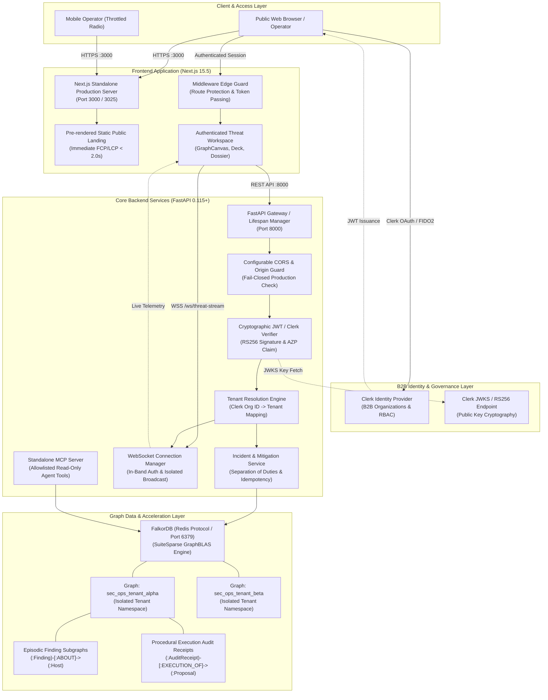
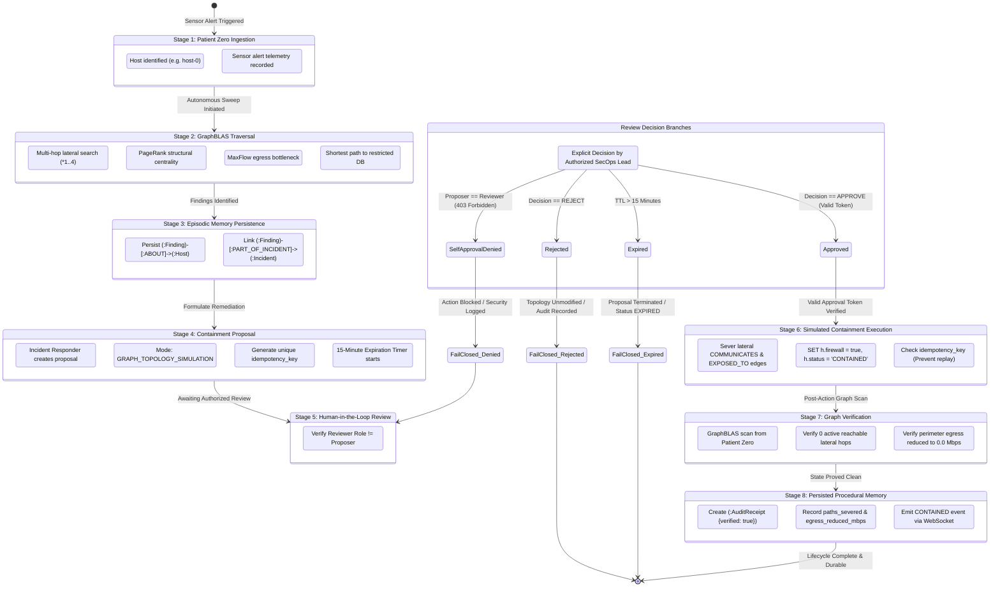
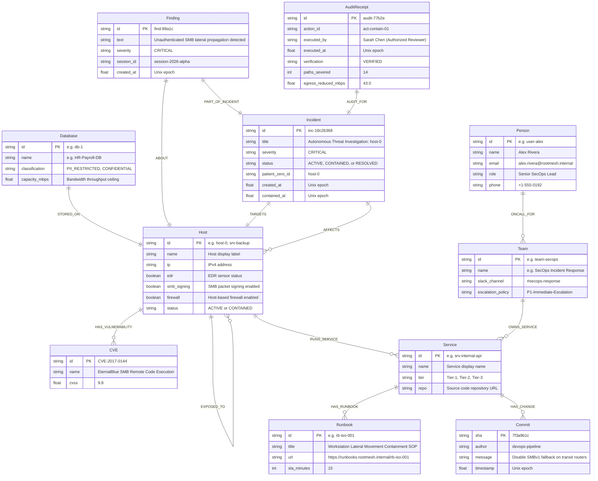

# RootMesh — System & Security Architecture Specification

**Product Version:** 0.1.0 (Simulation Release Candidate)
**Status:** Controlled Staging Candidate (Graph-Topology Simulation Only)
**Document Classification:** Engineering Architecture Reference

---

## 1. System Architecture Overview

RootMesh is a graph-native, multi-tenant threat intelligence and incident response system designed around **FalkorDB GraphBLAS** matrix acceleration. It combines a real-time reactive Next.js frontend with an asynchronous FastAPI backend and a hardware-accelerated property graph database.



### Core Architecture Components
1. **Frontend App (`frontend/app`)**: Built with Next.js 15.5 (App Router, Turbopack, Tailwind CSS v4). Serves pre-rendered static public landing pages for sub-second FCP, while dynamically mounting authenticated operational workspaces (SVG graph canvas, swipeable action deck, incident timeline).
2. **Backend App (`backend/app`)**: FastAPI asynchronous application running on Python 3.12+ / Uvicorn. Implements strict tenant isolation, role-based separation of duties, and in-band WebSocket telemetry.
3. **Identity Layer**: B2B multi-organization authentication powered by Clerk. Validated server-side via RS256 asynchronous public keys fetched from JWKS. Organization IDs map to dedicated FalkorDB tenant graphs.
4. **FalkorDB Graph Engine**: In-memory property graph engine leveraging SuiteSparse:GraphBLAS linear algebraic operations. Executes multi-hop Cypher traversals, PageRank centrality, and MaxFlow bandwidth bottlenecks in sub-35ms latencies.

---

## 2. Guarded Incident Response Lifecycle

RootMesh strictly implements an 8-stage Human-in-the-Loop lifecycle. Self-approval is architecturally prohibited, and all rejected, expired, or duplicate executions fail closed.



### Safety & Governance Guardrails
- **Separation of Duties**: The incident responder proposing containment (`containment:propose`) cannot authorize their own proposal. An explicit reviewer token with `containment:approve` is required.
- **Fail-Closed Default**: Rejections, expired proposals (TTL = 900 seconds), and unauthenticated attempts leave graph topologies completely untouched.
- **Idempotency Enforcement**: Every execution requires an `idempotency_key`. Duplicate submissions return cached audit receipts without re-executing edge severance.
- **Simulation Boundary**: Containment strictly operates in `GRAPH_TOPOLOGY_SIMULATION` mode inside FalkorDB. Hardware switch or firewall enforcement adapters remain external plugins.

---

## 3. FalkorDB Property Graph Data Model

The RootMesh graph schema represents enterprise infrastructure, vulnerability correlations, organizational ownership, runbook playbooks, and threat memory within unified tenant subgraphs.



**Illustrative diagram data:** The example identifiers, reviewer name, and numeric audit metrics are synthetic examples, not measured production results or physical network enforcement.


---

## 4. Security & Tenant Boundary Architecture

RootMesh implements multi-tenant isolation at both the application gateway and the database engine layers.

```mermaid
flowchart LR
    subgraph Ingress ["Client Request Context"]
        ReqA["Tenant Alpha Request\nHeader: Bearer <JWT>\nClerk Org: org_2secops_alpha"]
        ReqB["Tenant Beta Request\nHeader: Bearer <JWT>\nClerk Org: org_2secops_beta"]
        ReqBad["Tampered Request\nForged tenant_id: tenant_alpha\nClerk Org: org_2secops_beta"]
    end

    subgraph AuthGateway ["Authentication & Validation Gateway"]
        Verifier["RS256 JWT Signature Verifier\n(Checks Issuer & Expiration)"]
        PartyValidator["Authorized Party (AZP) Check\n(Checks Origin Against Allowlist)"]
        OrgMapper["Clerk Org Mapping Engine\n(Resolves Authorized Tenant Context)"]
        AccessGuard["Tenant Access Guard\n(Matches Requested vs Mapped Tenant)"]
    end

    subgraph DatabaseBoundary ["FalkorDB Database Boundary"]
        PoolManager["FalkorDB Connection Pool\n(Tenant-Validated Graph Selector)"]
        GraphAlpha[("Graph: sec_ops_tenant_alpha\n(Physical Graph Isolation)")]
        GraphBeta[("Graph: sec_ops_tenant_beta\n(Physical Graph Isolation)")]
    end

    ReqA --> Verifier
    ReqB --> Verifier
    ReqBad --> Verifier

    Verifier --> PartyValidator
    PartyValidator --> OrgMapper
    OrgMapper --> AccessGuard

    AccessGuard -->|Valid Alpha Context| PoolManager
    AccessGuard -->|Valid Beta Context| PoolManager
    AccessGuard -->|Mismatch Detected| Denied["403 Forbidden\nCross-Tenant Violation Blocked"]

    PoolManager -->|select_graph('sec_ops_tenant_alpha')| GraphAlpha
    PoolManager -->|select_graph('sec_ops_tenant_beta')| GraphBeta
```

### Security Boundary Guarantees
1. **Physical Namespace Segregation**: Tenant graphs in FalkorDB are completely separate named graphs (`select_graph(tenant_id)`). Cross-tenant queries are syntactically impossible because queries execute strictly within a single graph context.
2. **Server-Side Identity Derivation**: The active tenant context is derived strictly from verified Clerk Organization membership (`org_id`). Frontend-supplied tenant identifiers are cross-checked; mismatches fail immediately with `403 Forbidden`.
3. **In-Band WebSocket Authentication**: WebSocket connections on `/ws/threat-stream` reject query-string tokens (`?token=...`) to prevent credential leakage in proxy and server access logs. Connections must submit a cryptographic authentication frame within 5.0 seconds or face immediate termination.
4. **Test Database Guard (`app/db/test_guard.py`)**: All write-producing tests are hardwired to port 6380 and restricted to graph names prefixed with `test_`. Writes targeting port 6379 or production tenant graphs immediately abort execution with `TestDatabaseIsolationError`.
